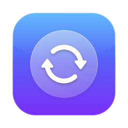
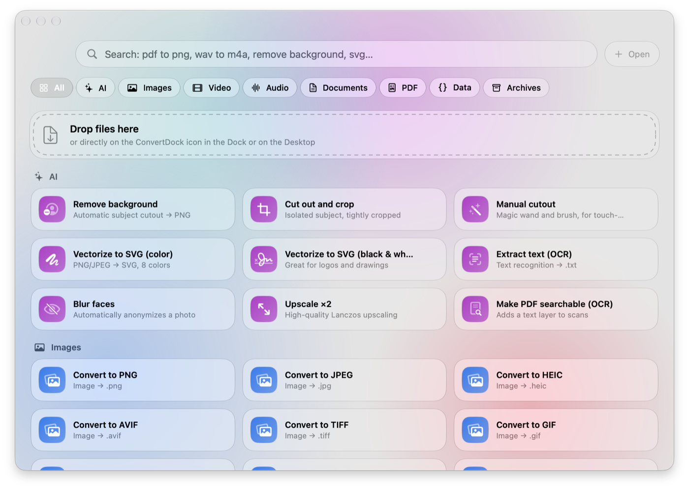
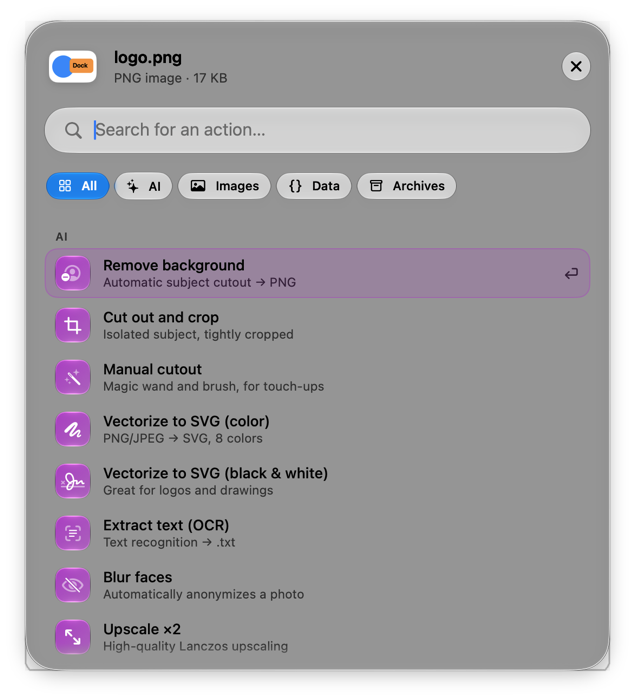
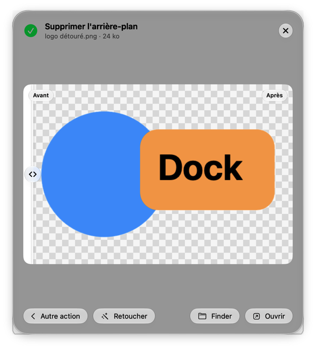

<p align="center">
  
</p>

<h1 align="center">ConvertDock</h1>

<p align="center">
  <b>A native macOS file converter, built with Liquid Glass.</b><br>
  Drop a file on the icon → pick an action → done.<br>
  117 tools · 100% on-device · zero dependencies · English & Français
</p>

<p align="center">
  
</p>

<p align="center"><a href="#français">🇫🇷 Version française plus bas</a></p>

## How it works

- **Drop a file on the ConvertDock icon** (in the Dock or on your Desktop): a glass panel opens with **every conversion available** for that file.
- **Type to search** — it understands natural queries like `pdf to png`, `wav vers mp3`, `heic en jpg`, `mov → mp4`, `pdf2png`. When a format can't be produced natively (MP3, WebP, MKV…), it tells you why and offers the closest equivalent.
- Navigate with **↑ ↓**, run with **↩**, close with **Esc**.
- Or use the main window: drag & drop, search, category filters, job history.
- In Finder: right-click › **Services** › **Convert with ConvertDock**.

<p align="center">
  
  &nbsp;
  
</p>

Everything runs **on your Mac** using Apple frameworks (Vision, Core Image, ImageIO, AVFoundation, AVKit, PDFKit, AppKit). No file ever leaves your computer.

## Tools

| Category | Actions |
|---|---|
| ✨ **AI** | Remove background · Cut out and crop (sticker) · **Manual cutout** (magic wand, eraser, restore brush) · **PNG → SVG** in color or black & white · OCR (image → text) · **Transcribe audio/video to text** · **Generate subtitles (.srt)** · **Read text aloud to audio** · Blur faces · Upscale ×2 · Make a PDF searchable |
| 🖼️ **Images** | Convert to PNG, JPEG, HEIC, AVIF, TIFF, GIF, BMP, ICO, PSD, JPEG 2000, OpenEXR, TGA, KTX, DDS, PDF · macOS `.icns` icon · **Favicon pack** (ICO + PNG 16→512 + HTML + manifest) · SVG → PNG @1x/@2x/@3x · Shrink, resize · Compress · Black & white · Rotate · Flip · Strip EXIF/GPS · Combine into a PDF · Animated GIF · Extract GIF frames |
| 🎬 **Video** | **Trim** · MP4 (H.264) · HEVC (H.265) · **ProRes 422 / 4444** · MOV · M4V · 1080p · 720p · 480p · Remove sound · Speed up ×2 / slow down ×0.5 · Rotate 90° (lossless) · Extract audio · Video → GIF · Capture a frame · Extract all frames |
| 🎧 **Audio** | **Trim** · **iPhone ringtone (.m4r)** · M4A (AAC, also 256 / 96 kbps) · Opus · WAV · AIFF · CAF · FLAC · Apple Lossless |
| 📄 **Documents** | Markdown, RTF, DOCX, DOC, ODT, HTML, TXT → PDF, Word, ODT, RTF, RTFD, HTML, Web Archive, TXT · Markdown → styled HTML · Code → PDF · Word count · Subtitles SRT ⇄ WebVTT |
| 📕 **PDF** | PDF → PNG / JPEG / TXT / RTF · Merge · Split pages · Compress · Rotate |
| 🧊 **3D** | OBJ, STL, PLY, USD, USDZ, Alembic → **USDZ** (AR Quick Look), OBJ, STL (3D printing), PLY, USD |
| `{}` **Data** | JSON ⇄ YAML · JSON ⇄ Plist · JSON ⇄ CSV · CSV → HTML / Markdown table · Plist binary ⇄ XML · Format / minify JSON · Base64 · SHA-256 |
| 🗜️ **Archives** | ZIP · TAR.GZ · TAR.XZ · Apple Archive (.aar) · **Disk image (.dmg)** · Decompress (zip, tar, gz, xz, aar…) |

> Not possible natively (would require bundling third-party encoders): writing MP3, WebP, MKV, OGG, EPUB, XLSX. The smart search explains this and offers the closest native format.

### Results you can check — and fix

Every tool that produces an image shows the result right away with a **before / after slider**. After a background removal, **Touch up** opens the manual cutout editor pre-filled with the automatic result. If no subject is detected at all, the editor opens by itself so you can click the background away with the magic wand.

### Trim audio & video

**Trim** opens macOS's native trimming UI (the one from QuickTime Player). MOV / MP4 / M4V are cut **without re-encoding** (instant and lossless); WAV / AIFF / CAF / FLAC are cut sample-accurately in their original format.

### PNG → SVG

The vectorizer quantizes colors (k-means), traces each color layer with Vision (`VNDetectContoursRequest`), simplifies the contours and smooths them into Bézier curves while keeping sharp corners. Great for logos, icons and flat illustrations.

## Install

Requires **macOS 26 (Tahoe) or later** and the developer tools (Xcode, or just `xcode-select --install`).

```bash
git clone https://github.com/sivelswhy/ConvertDock.git
cd ConvertDock
make install
```

`make install` builds a release app, installs it in `/Applications`, registers it with macOS (drop-on-icon, Finder service) and creates a **Desktop shortcut**. To skip the shortcut: `NO_DESKTOP_ALIAS=1 make install`.

```bash
make app     # build build/ConvertDock.app
make run     # build and launch
```

> The app is ad-hoc signed. If macOS refuses to open it after a download, right-click › Open.

## Command line

```bash
CD=/Applications/ConvertDock.app/Contents/MacOS/ConvertDock
$CD --list                                    # list tools and their identifiers
$CD --search "wav to mp3"                     # try the smart search
$CD --run ai.removebg photo.jpg               # remove background
$CD --run ai.vectorize.color logo.png         # PNG → SVG
$CD --run video.trim --trim 12.5 30 film.mov  # keep 12.5 s → 30 s
$CD --run pdf.merge a.pdf b.pdf c.pdf         # merge
```

## Settings

- Where to save results: next to the original (default), Downloads or Desktop
- Reveal in Finder when done, completion sound
- Auto-close the quick panel when done

## Localization

Source strings are English; translations live in `Resources/<lang>.lproj/Localizable.strings` (French included). The app follows the system language.

```bash
./Scripts/check-localization.sh   # lists keys missing from the French file
python3 Scripts/fr-translations.py  # regenerates fr.lproj/Localizable.strings
```

Search works in both languages whatever the UI language: French keywords (`détourer`, `compresser`, `vers`, `en`…) and English ones are all understood.

## Architecture

```
Sources/ConvertDock/
├── App/          AppKit lifecycle, menus, floating glass panel (NSGlassEffectView), CLI
├── Core/         Tool model, registry, smart search, job runner, output location
├── Converters/   One file per family: images, Vision, vectorizer, video, audio, trim, documents, PDF, data, archives
└── UI/           Liquid Glass SwiftUI views, before/after preview, cutout editor, trim editor
```

Adding a tool = adding a `Tool` (English title, SF Symbol, accepted types, keywords, `run` function) in one of the `Converters/` files, plus its French translation. It automatically shows up in search, the grid and the quick panel for compatible files.

> The project builds with Command Line Tools only: since `@State` is a macro in the macOS 27 SDK (whose plugin ships with Xcode), views use the `ViewState` alias that points straight at the property wrapper.

---

## Français

**ConvertDock** est un convertisseur de fichiers natif pour macOS, en Liquid Glass, entièrement traduit en français (l'app suit la langue du système).

- **Déposez un fichier sur l'icône** (Dock ou Bureau) : un panneau en verre propose toutes les conversions possibles.
- **Recherche naturelle** : « pdf en png », « wav vers mp3 », « heic en jpg »… Si un format n'est pas disponible nativement (MP3, WebP…), l'app l'explique et propose l'équivalent.
- **117 outils** : détourage automatique et manuel, PNG → SVG, OCR, transcription et sous-titres, lecture à voix haute, pack favicon, conversions d'images, vidéo (ProRes, vitesse, rotation), audio (Opus, sonnerie iPhone), documents, PDF, 3D (USDZ, STL, OBJ), données (YAML), archives (DMG, TAR.GZ), **trim audio/vidéo**.
- **Aperçu avant/après** de chaque résultat image, et bouton **Retoucher** après un détourage.
- 100 % local, aucune dépendance.

Installation : `git clone https://github.com/sivelswhy/ConvertDock.git && cd ConvertDock && make install` (macOS 26 minimum).

## License

MIT
