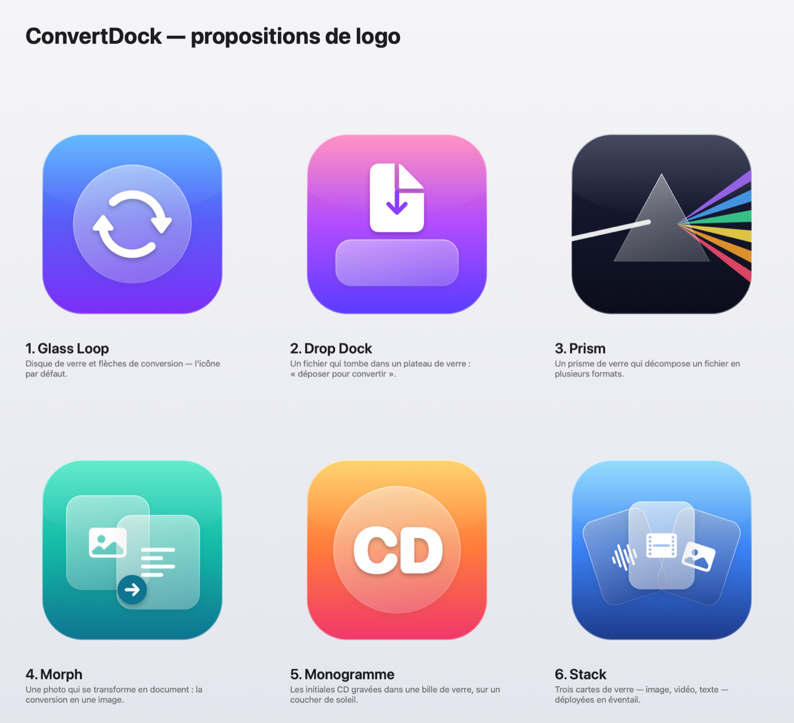

<p align="center">
  
</p>

<h1 align="center">ConvertDock</h1>

<p align="center">
  <b>Le convertisseur de fichiers natif pour macOS, en Liquid Glass.</b><br>
  Déposez un fichier sur l'icône → choisissez une action → c'est fait.<br>
  77 outils · 100 % local · aucune dépendance
</p>

<p align="center">
  
</p>

## Le principe

- **Déposez un fichier sur l'icône** de ConvertDock (dans le Dock ou sur le Bureau) : un panneau en verre s'ouvre avec **toutes les conversions possibles** pour ce fichier.
- **Tapez pour chercher** (`svg`, `détourer`, `mp4`, `compresser`…), naviguez avec **↑ ↓**, lancez avec **↩**, fermez avec **Échap**.
- Ou utilisez la fenêtre principale : glisser-déposer, recherche, filtres par catégorie, historique des tâches.
- Aussi dans le Finder : clic droit › **Services** › **Convertir avec ConvertDock**.

<p align="center">
  
</p>

Tout est fait **sur votre Mac** grâce aux frameworks d'Apple (Vision, Core Image, ImageIO, AVFoundation, PDFKit, AppKit). Aucun fichier n'est envoyé sur Internet.

## Les outils

| Catégorie | Actions |
|---|---|
| ✨ **Intelligence** | Supprimer l'arrière-plan · Détourer et recadrer (sticker) · **PNG → SVG** couleur et noir & blanc · OCR (image → texte) · Flouter les visages · Agrandir ×2 · Rendre un PDF cherchable (OCR) |
| 🖼️ **Images** | Convertir en PNG, JPEG, HEIC, AVIF, TIFF, GIF, BMP, ICO, PSD, PDF · Icône macOS `.icns` · Réduire, redimensionner (1920 / 1080 / 512 px) · Compresser · Noir et blanc · Pivoter · Miroir · Supprimer EXIF/GPS · Assembler en PDF · Créer un GIF animé · Extraire les frames d'un GIF |
| 🎬 **Vidéo** | **Couper (trim)** · MP4 (H.264) · HEVC (H.265) · MOV · M4V · 1080p · 720p · 480p · Extraire l'audio · Vidéo → GIF · Capturer une image |
| 🎧 **Audio** | **Couper (trim)** · M4A (AAC) · WAV · AIFF · CAF · FLAC · Apple Lossless |
| 📄 **Documents** | Markdown, RTF, DOCX, DOC, ODT, HTML, TXT → PDF, Word, ODT, RTF, HTML, TXT · Markdown → HTML stylé · Code → PDF · Compter les mots |
| 📕 **PDF** | PDF → PNG / JPEG / TXT / RTF · Fusionner · Séparer les pages · Compresser · Pivoter |
| `{}` **Données** | JSON ⇄ Plist · JSON ⇄ CSV · Formater / minifier le JSON · Base64 · SHA-256 |
| 🗜️ **Archives** | Compresser en ZIP · Décompresser (zip, tar, gz…) |

### Trim audio / vidéo

« Couper » ouvre l'éditeur de découpe natif de macOS (celui de QuickTime Player) : déplacez les poignées jaunes puis cliquez sur **Couper**. MOV / MP4 / M4V sont coupés **sans réencodage** (instantané, sans perte), WAV / AIFF / CAF / FLAC à l'échantillon près dans leur format d'origine.

### PNG → SVG

La vectorisation quantifie les couleurs (k-means), trace les contours de chaque couleur avec Vision (`VNDetectContoursRequest`), les simplifie puis les lisse en courbes de Bézier en conservant les angles vifs. Idéal pour les logos, icônes et illustrations en aplats.

## Installation

Il faut **macOS 26 (Tahoe) ou plus récent** et les outils de développement (Xcode ou simplement `xcode-select --install`).

```bash
git clone https://github.com/sivelswhy/ConvertDock.git
cd ConvertDock
make install
```

`make install` compile l'app en release, l'installe dans `/Applications`, l'enregistre auprès de macOS (dépôt sur l'icône, service Finder) et crée un **raccourci sur le Bureau**. Pour ne pas créer le raccourci : `NO_DESKTOP_ALIAS=1 make install`.

Autres commandes :

```bash
make app     # construit build/ConvertDock.app
make run     # construit puis lance l'app
make logos   # régénère les propositions de logo dans ./Logos
```

> L'app est signée « ad hoc ». Si macOS refuse de l'ouvrir après un téléchargement, faites clic droit › Ouvrir.

## Ligne de commande

Le binaire sait aussi s'utiliser dans un terminal ou un script :

```bash
CD=/Applications/ConvertDock.app/Contents/MacOS/ConvertDock
$CD --list                                    # liste les outils et leurs identifiants
$CD --run ai.removebg photo.jpg               # supprime l'arrière-plan
$CD --run ai.vectorize.color logo.png         # PNG → SVG
$CD --run video.trim --trim 12.5 30 film.mov  # garde de 12,5 s à 30 s
$CD --run pdf.merge a.pdf b.pdf c.pdf         # fusionne
```

## Réglages

- Emplacement des fichiers créés : à côté de l'original (par défaut), Téléchargements ou Bureau
- Afficher dans le Finder à la fin, son de fin
- Fermer automatiquement le panneau rapide une fois terminé

## Architecture

```
Sources/ConvertDock/
├── App/          Cycle de vie AppKit, menus, panneau flottant (NSGlassEffectView), CLI
├── Core/         Modèle Tool, registre, exécution des tâches, emplacement de sortie
├── Converters/   Un fichier par famille : images, Vision, vectorisation, vidéo, audio, trim, documents, PDF, données, archives
└── UI/           Vues SwiftUI en Liquid Glass (glassEffect, GlassEffectContainer, boutons .glass)
```

Ajouter un outil = ajouter un `Tool` (titre, symbole SF, types acceptés, mots-clés, fonction `run`) dans l'un des fichiers de `Converters/`. Il apparaît automatiquement dans la recherche, la grille et le panneau rapide pour les fichiers compatibles.

> Le projet se compile avec les seuls Command Line Tools : `@State` étant une macro dans le SDK macOS 27 (plugin fourni avec Xcode uniquement), les vues utilisent l'alias `ViewState`, qui pointe directement vers le property wrapper.

## Logo

Six propositions sont générées par `Scripts/generate-logos.swift` (la n° 1 est l'icône actuelle) :

<p align="center">
  
</p>

## Licence

MIT
